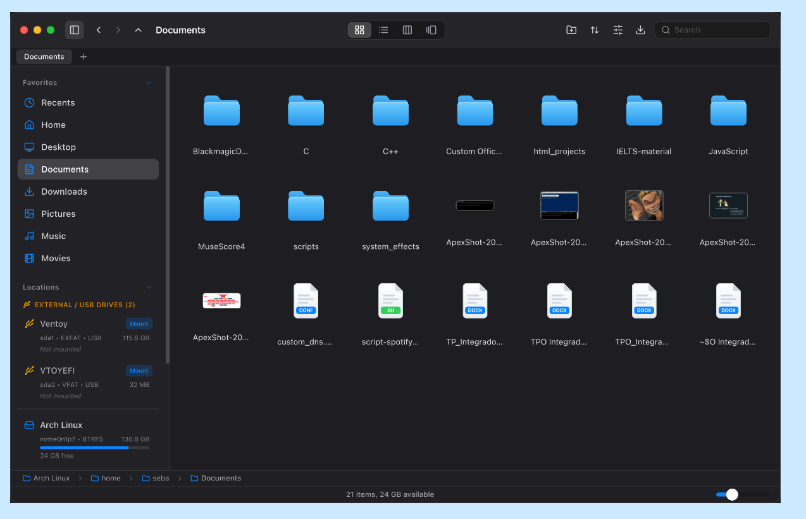

# vFinder #

a macOS-inspired desktop file manager for Linux

## What is this? ##

A file explorer written in TypeScript, TailWind, and Rust

## Why would I use it? ##

It looks cool! currently, there are many other incredible good options around here, but none of them looks like macos' file explorer (finder)
Altough It's way far from perfect right now, I believe it can be a usable daily driver for those who enjoy this aesthetic 

### IMPORTANT!!! ###
1. If you want to use apple's fonts, you have to obtain them from their official website, however, fallback fonts that are commonly bundled in Linux distros are included
2. Optionally, this program includes a download manager function, which you can use by executing a small .sh script and installing a chrome extension which intercepts downloads (yeah, quite messy, oh, and for now it only works for edge, chrome, and Brave)

## Features? ##

- Drag & Drop between programs
- split tabs
- thumbnail previsualization
- Download manager (optional)

## Compatible distros ##

There's an appImage that bundles necessary libraries.

Also, dependencies are handled automatically if installed using the correct release according to your distro (.deb, .rpm, .pkg).
But if you want to know a bit more about what's being installed on your device, there's a list below so you can check!

Ubuntu (26.04 LTS, 25.04 LTS, 24.04 LTS, 23.04 LTS, 22.04 LTS) ☑️ tested

Debian (13, 12) ☑️ tested

Arch and derivatives ☑️ tested

Fedora ☑️ tested

### Archive support

ZIP creation, viewing, and extraction are built into vFinder. Reading and extracting TAR archives is also supported for `.tar`, `.tar.gz` / `.tgz`, `.tar.bz2` / `.tbz` / `.tbz2`, `.tar.xz` / `.txz`, `.tar.zst` / `.tzst`, and `.tar.lzma` files. No separate `zip` command or archive utility is required at runtime.

## Build from source ##

These are the dependencies youll need if you want to compile it by yourself: (ubuntu)

    sudo apt install -y \
      build-essential \
      pkg-config \
      libwebkit2gtk-4.1-dev \
      libgtk-3-dev \
      libsoup-3.0-dev \
      libxdo-dev \
      libayatana-appindicator3-dev \
      librsvg2-dev \
      libssl-dev \
      curl \
      wget \
      file \
      nodejs \
      npm

Install Rust using rustup and Node.js 18.x, 20.x, or 22+, then build vFinder with `npm install` and `npm run tauri build`. The Linux build packages above follow [Tauri's Linux prerequisites](https://v2.tauri.app/start/prerequisites/).

### Optional browser download integration

The native messaging host used by the optional browser download integration requires Python 3: install `python3` on Ubuntu/Debian/Fedora or `python` on Arch. `curl` is listed as a runtime dependency because vFinder also uses it for URL downloads.
